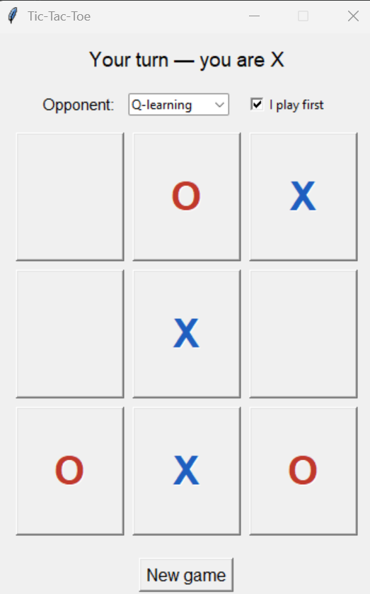
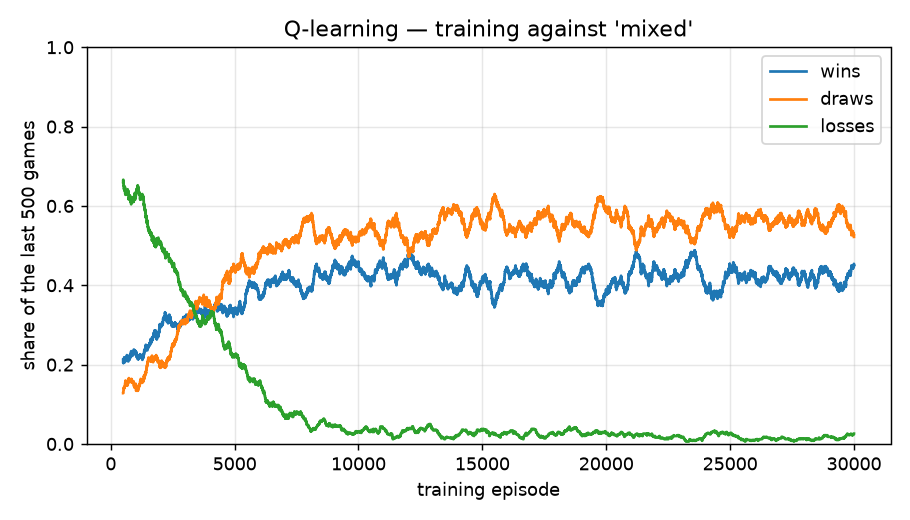
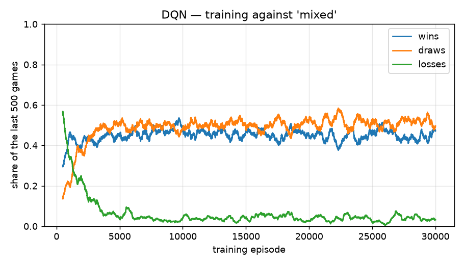

# Tic-Tac-Toe — Reinforcement Learning

Agents that learn to play tic-tac-toe by trial and error, implemented from scratch with
**tabular Q-learning** and a **Deep Q-Network (DQN)** in PyTorch. The project includes the
game environment, a training loop, a perfect-play **Minimax** reference opponent, a
round-robin evaluation, and a small GUI to play against the agents.

<p align="center">
  
</p>

## Results

Both agents were trained for 30,000 games against a mix of random and perfect (Minimax)
opponents, playing as X and as O. They are then evaluated with **no exploration**, in a
round-robin of 1,000 games per pair, where the two players alternate who starts
(`python -m src evaluate`, seed 42):

<!-- Replace with the output of: python -m src evaluate
     Neural networks vary between runs and machines: use YOUR numbers for the DQN rows. -->

| Agent A | Agent B | Games | A wins | B wins | Draws |
|---|---|---:|---:|---:|---:|
| Random | Minimax | 1000 | 0 (0.0%) | 856 (85.6%) | 144 (14.4%) |
| Random | Q-learning | 1000 | 8 (0.8%) | 844 (84.4%) | 148 (14.8%) |
| Random | DQN | 1000 | 10 (1.0%) | 914 (91.4%) | 76 (7.6%) |
| Minimax | Q-learning | 1000 | 0 (0.0%) | 0 (0.0%) | 1000 (100.0%) |
| Minimax | DQN | 1000 | 10 (1.0%) | 0 (0.0%) | 990 (99.0%) |
| Q-learning | DQN | 1000 | 0 (0.0%) | 0 (0.0%) | 1000 (100.0%) |

What this shows:

- **Q-learning never loses to the perfect player** (1000/1000 draws). Tic-tac-toe is a
  solved game: the best possible outcome against perfect play is a draw.
- **The DQN wins more often against a weak opponent but is slightly less reliable against a
  perfect one.** It beats the random player more often than the table does (91% vs 84%), but
  it lost 1% of its games to Minimax, so its policy is not perfectly optimal. It also learns
  faster early in training (see the curves below).
- **On a game this small, the table is the better tool.** It stores an exact value for every
  position, while the network only approximates them. The DQN is included as the method that
  would scale to boards too large for a table.
- Minimax is optimal against a *perfect* opponent, not against a random one: it does not try
  to set traps, which is why the learned agents can win more often than it does against
  `Random`.
- **Training against a random opponent alone is not enough.** A Q-learning agent trained for
  10,000 games against `random` only lost **41.8%** of its games to Minimax, versus **5.0%**
  with the `mixed` opponent at the same budget. This is why `mixed` is the default.

### Learning curves

Share of wins / draws / losses over a sliding window of training games (this includes
exploratory moves). Against the mixed opponent, half of the games are against a perfect
player that cannot be beaten, so the win rate plateaus around 40–45% while losses fall
close to 0.

| Q-learning | DQN |
|---|---|
|  |  |

## Quick start

Requires Python 3.10+.

```bash
python -m venv .venv
source .venv/bin/activate          # Windows: .venv\Scripts\activate
pip install -r requirements.txt
```

The repository ships with trained models in `models/`, so you can play right away:

```bash
python -m src play                       # GUI (Tkinter)
python -m src evaluate --games 1000      # round-robin between all agents
python -m src train                      # retrain both agents (a few minutes on CPU)
```

Useful options:

```bash
python -m src train --agents dqn --episodes 50000
python -m src train --agents q_learning --opponent minimax
python -m src train --plot-dir docs      # also save learning curves (matplotlib)
python -m src --help
```

PyTorch is only needed for the DQN agent; the CPU build is enough. Tkinter ships with Python
on Windows and macOS; on Debian/Ubuntu install it with `sudo apt install python3-tk`.

## How it works

**Environment.** The board is a list of 9 cells (`1` = X, `-1` = O, `0` = empty). X always
starts. A state is the full board; an action is the index of an empty cell.

**Rewards.** +1 for a win, −1 for a loss, 0 for a draw or a non-terminal move.

**Point of view.** Boards are multiplied by the agent's own sign before being used, so the
agent always sees its own marks as `1`. One Q-table (or one network) therefore serves both
as X and as O, and the trainer alternates the agent's side every episode.

**Q-learning** keeps a table `Q(state, action)` updated after each of the agent's moves:

```
Q(s, a) ← Q(s, a) + α · (r + γ · max_a' Q(s', a') − Q(s, a))
```

where `s'` is the board the agent sees at its next turn (after the opponent's reply), and
the target is just `r` when the game is over. Exploration is ε-greedy with a per-episode
decay.

**DQN** replaces the table with a small MLP (9 → 64 → 64 → 9), with experience replay, a
target network synchronised every 100 steps, Huber loss and gradient clipping. Illegal moves
are masked both when acting and when computing the target `max Q_target(s', ·)`.

**Minimax** is a memoised negamax search: it explores every possible continuation and picks
a move with the best guaranteed outcome, choosing at random among equally good moves. The
whole game has about 5,500 reachable positions, so it runs instantly.

**Opponents** (`--opponent`): `random`, `minimax`, or `mixed` (each game against one of the
two, chosen at random).

## Project structure

```
src/
├── environment/board.py        # game rules
├── agents/
│   ├── base.py                 # BaseAgent interface
│   ├── random_agent.py
│   ├── minimax_agent.py        # perfect-play reference
│   ├── q_learning.py
│   └── dqn.py
├── training/                   # Trainer, opponents, learning-curve plot
├── evaluation/                 # Evaluator, metrics, round-robin report
├── ui/graphical_interface.py   # Tkinter GUI
├── registry.py                 # how each agent is built / loaded
└── cli.py                      # python -m src {train,evaluate,play}
models/                         # trained agents (Q-table as JSON, DQN checkpoint)
tests/                          # pytest suite
docs/                           # screenshot and learning curves
```

## Tests

```bash
pip install -e ".[dev]"
pytest
```

The suite covers the game rules, the Q-learning update (hand-computed values), the symmetry
between X and O, Minimax optimality (never loses, always draws against itself), model
save/load, the DQN target masking, and a short training run. The DQN tests are skipped
automatically when PyTorch is not installed.

## Limitations and ideas

- Opponents during training are only random or Minimax. There is **no self-play**, so the
  agents have not been tested against styles of play that are neither random nor perfect.
- Evaluation uses 1,000 games per pair with a fixed seed, and each agent was trained once;
  small differences (such as 1% of games) are within noise and should not be
  over-interpreted. Comparing several training seeds would give a firmer conclusion.
- Tabular Q-learning only works because the state space is tiny (a few thousand reachable
  positions); the DQN is the approach that would scale to larger boards.
- Possible next steps: self-play, Double DQN, larger boards (4×4, Connect Four), and
  exploiting board symmetries to speed up learning.
